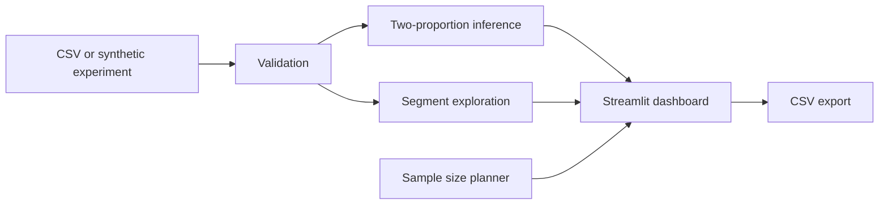

<p align="center"></p>

# ExperimentLab AI

**A/B Testing, Conversion Uplift & Experimentation Intelligence** — a self-contained, open-source demonstration of two-arm randomized experiment analysis using synthetic data. Built for the [ZubairLabs](https://zubairlabs.com) Data Science portfolio.

## Features

| Module | Description |
|---|---|
| Experiment Overview | Conversion rates, absolute and relative uplift, two-sided p-value and confidence interval |
| Assignment diagnostics | 50/50 sample-ratio mismatch detection |
| Segment Explorer | Exploratory device-level comparisons, with multiple-testing warning |
| Sample Size Planner | Approximate per-arm sample size for relative minimum detectable effect |
| CSV Import/Export | User-provided experiment data, validated binary outcomes, downloadable data |
| Methodology | Explicit assumptions, limitations, and test definitions |

## Quick start

```bash
python -m venv .venv
# Linux/macOS: source .venv/bin/activate
# Windows: .venv\\Scripts\\activate
pip install -r requirements.txt
streamlit run app.py
```

Run tests: `python -m pytest -q`.

## Data schema

Required columns: `variant` (exactly two groups), `converted` (0 or 1). Optional: `user_id` (unique per row), `device` (segment analysis). Upload a CSV in the sidebar or use the included synthetic dataset (`data/sample_experiment.csv`, generated deterministically with seed 42). Each row must represent one independent randomized unit.

## Statistical methodology

1. Compute conversion rate as successes / assigned units for each arm.
2. Use a two-sided pooled two-proportion z-test for equality of conversion rates.
3. Compute an unpooled Wald confidence interval for the absolute difference in conversion rates, and Wilson intervals for individual rates.
4. Check sample ratio mismatch with a chi-square goodness-of-fit statistic, assuming a 50/50 allocation. Flag at p < 0.001.
5. Plan sample sizes using the standard normal approximation with equal allocation.

**Cautions:** Wald intervals may be unreliable with small samples or extreme conversion rates; normal approximations may fail for sparse outcomes. Segment analyses are exploratory and unadjusted for multiple comparisons. Repeated peeking or optional stopping invalidates nominal p-values unless a suitable sequential method is used. Real causal interpretation requires sound randomization, instrumentation, stable exposure, and predefined outcomes. No production suitability or real-world uplift is claimed.

## Architecture



## Repository layout

```text
experimentlab-ai/
├── app.py
├── core.py
├── data/sample_experiment.csv
├── tests/test_core.py
├── assets/hero.svg
├── .github/workflows/tests.yml
├── requirements.txt
├── README.md
└── GITHUB_STREAMLIT_MASTER_PROMPT.md
```

## Deployment

Push the repository to GitHub, then select `app.py` as the entry point on Streamlit Community Cloud. Do not publish a live-demo badge until the URL and dashboard are verified.

## Roadmap

Sequential testing with alpha spending; covariate-adjusted estimation; stratified randomization; multiple-comparison correction; power simulations; experiment registry.

**Author:** ZubairLabs • [GitHub](https://github.com/muhammadzubair-data) • [Portfolio](https://zubairlabs.com)
