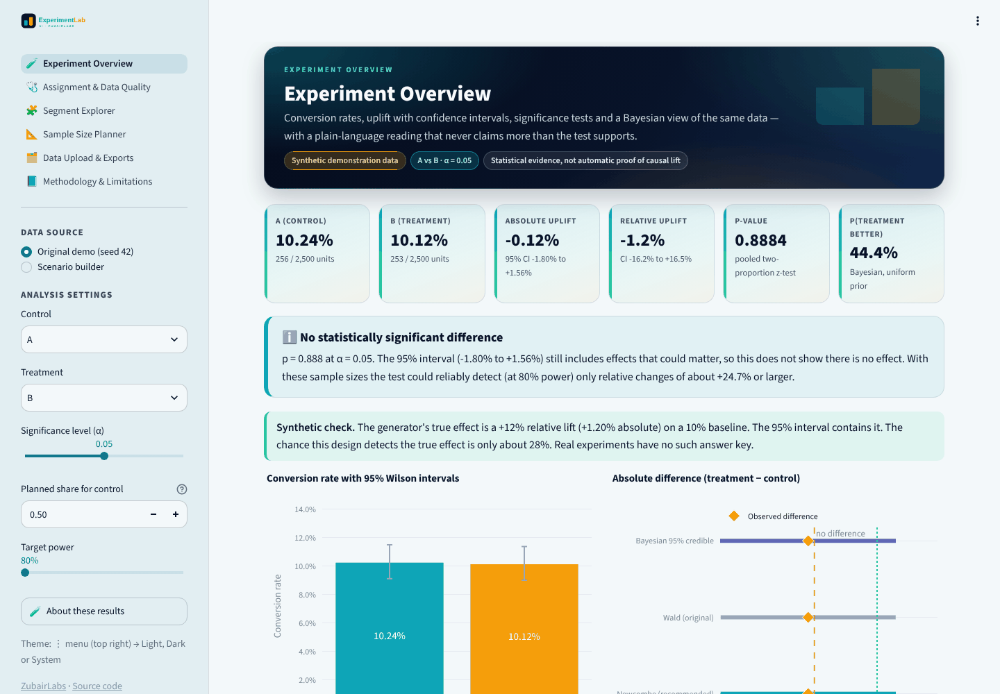
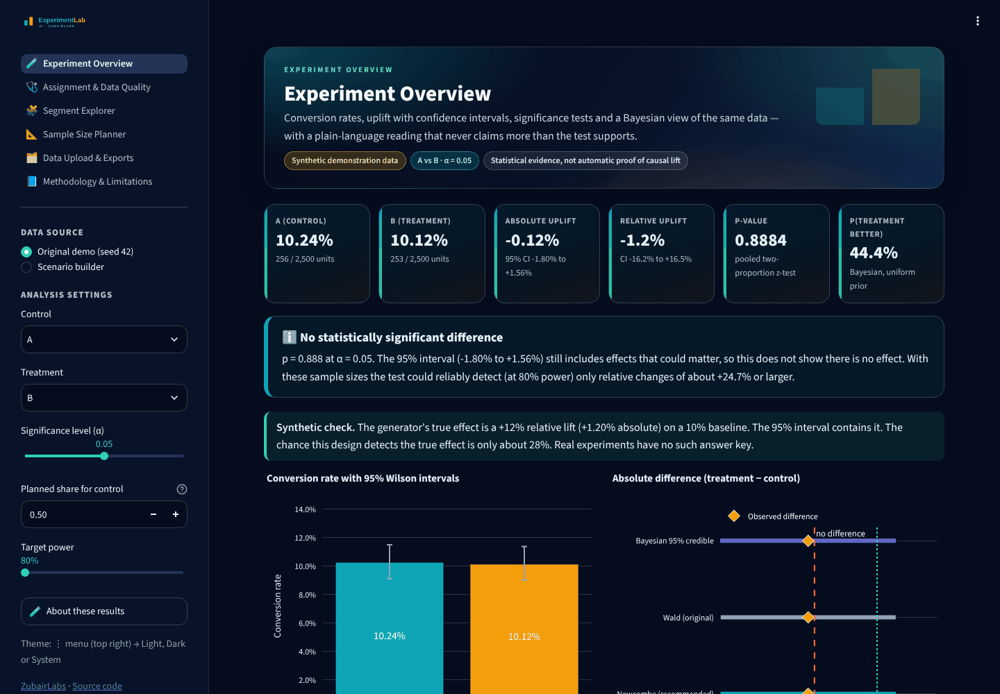
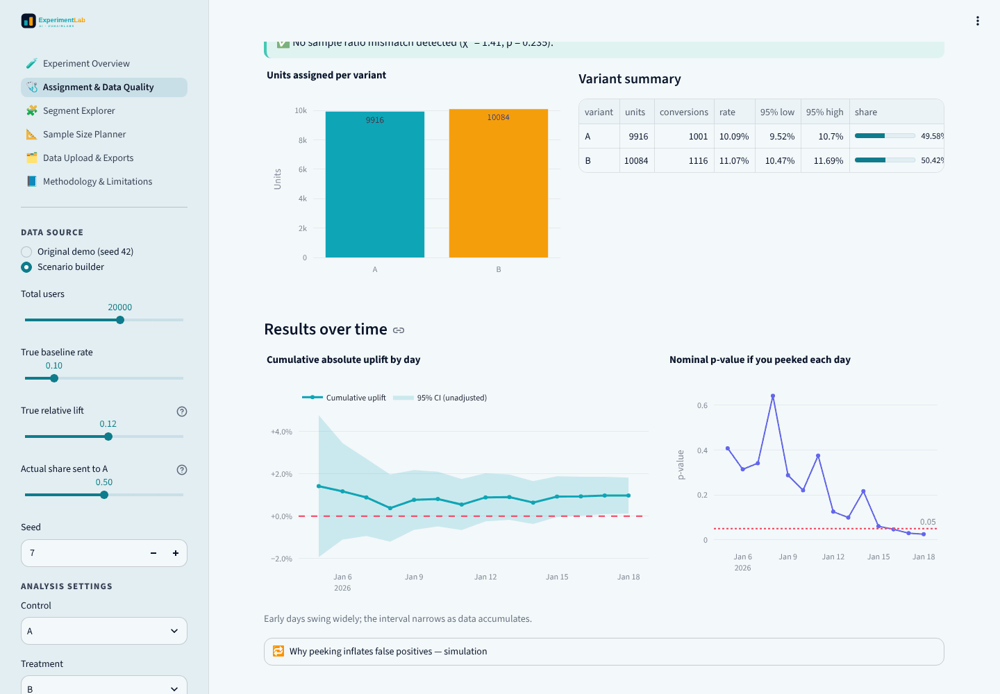
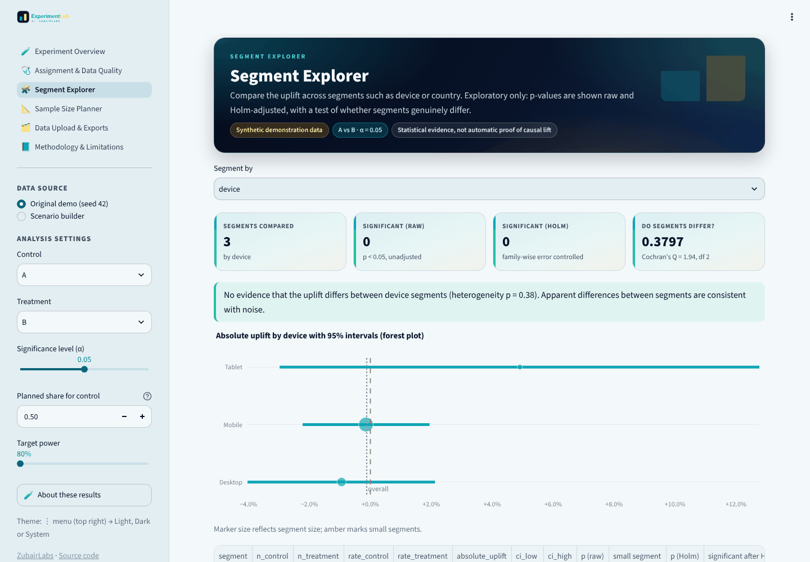
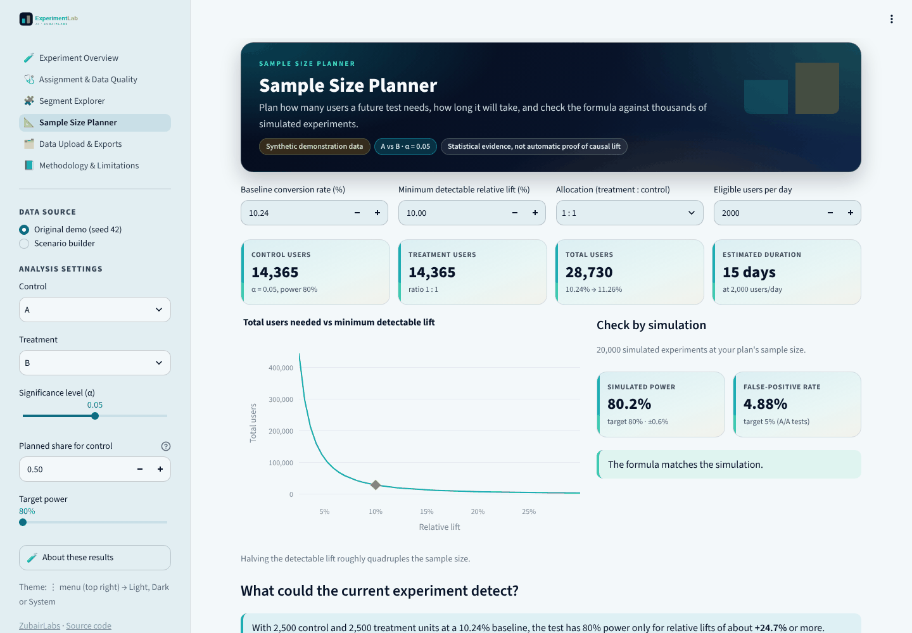
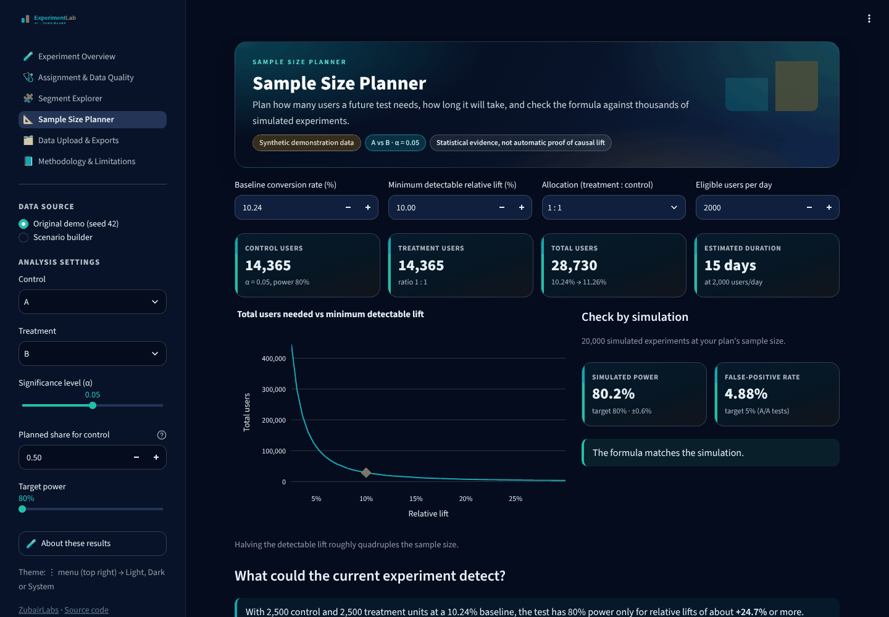
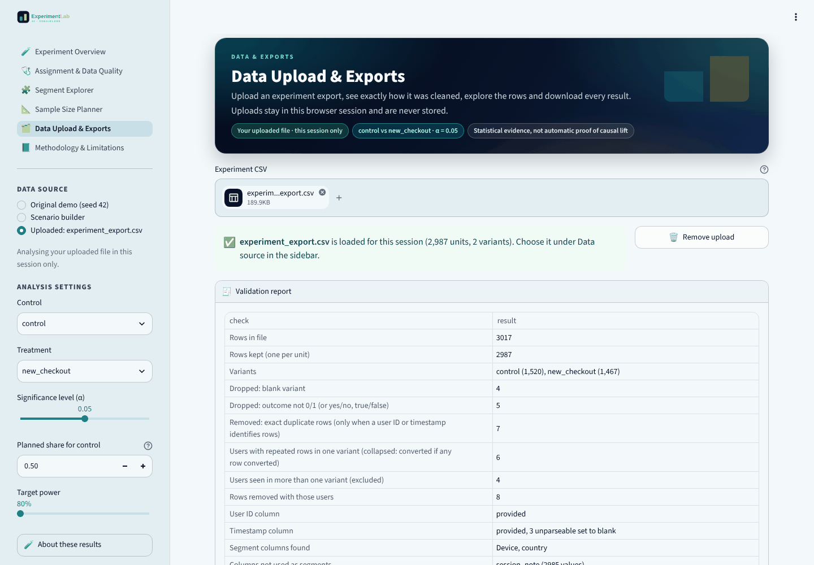
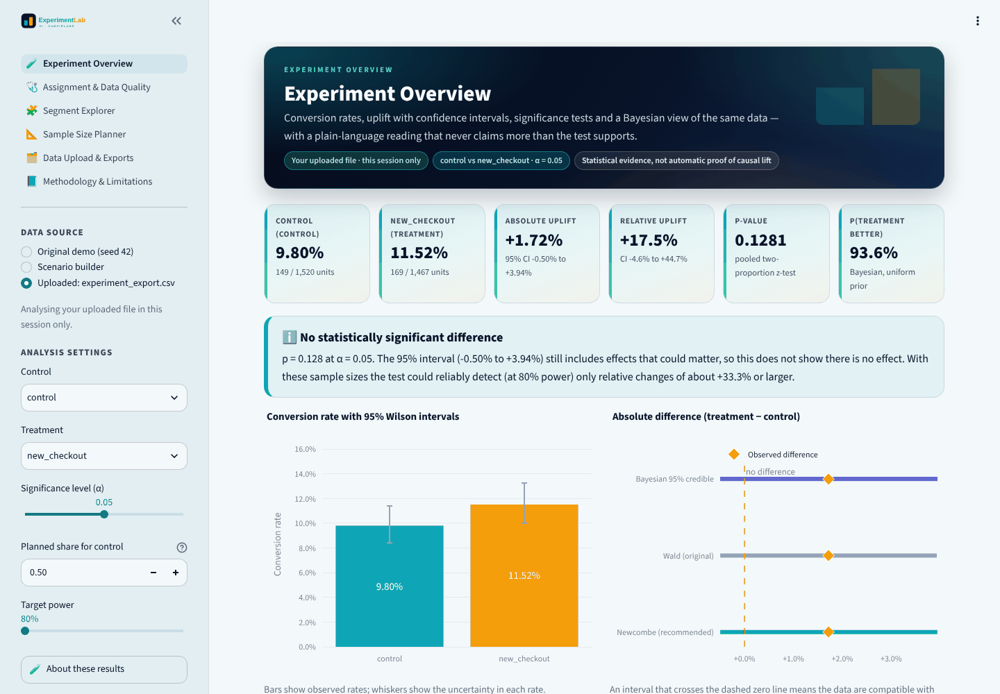
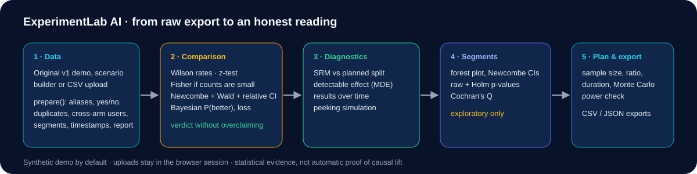

<p align="center"></p>

<div align="center">

# ExperimentLab AI

**A/B testing, conversion uplift and experimentation intelligence — with statistics that are checked, and a
dashboard that never claims more than the test supports.**

<!-- LIVE-BADGE -->
[](https://github.com/muhammadzubair-data/experimentlab-ai-ab-testing-intelligence/actions/workflows/ci.yml)


Built by [ZubairLabs](https://zubairlabs.com) · Muhammad Zubair

</div>

> **Synthetic data.** Every bundled result comes from simulated experiments with a known true effect. A significant
> result supports a causal effect only if randomization, exposure and tracking were sound — the app cannot verify
> that for you, and it says so on every page.

## Contents

1. [Live demo](#live-demo)
2. [What it does](#what-it-does)
3. [Screenshots](#screenshots)
4. [Key findings on the demo data](#key-findings-on-the-demo-data)
5. [What changed from v1](#what-changed-from-v1)
6. [Statistical methodology](#statistical-methodology)
7. [How the statistics were verified](#how-the-statistics-were-verified)
8. [Uploading your own CSV](#uploading-your-own-csv)
9. [Architecture and project structure](#architecture-and-project-structure)
10. [Quick start](#quick-start)
11. [Testing and CI](#testing-and-ci)
12. [Limitations](#limitations)
13. [Roadmap](#roadmap)
14. [Author](#author)

## Live demo

<!-- LIVE-SECTION -->

## What it does

| Page | What you get |
|:--|:--|
| **Experiment Overview** | Rates with Wilson intervals, absolute and relative uplift, Newcombe / Wald / Bayesian intervals, p-value (Fisher's exact test when counts are small), probability the treatment is better, a plain-language verdict, synthetic truth check, CSV/JSON export |
| **Assignment & Data Quality** | Sample ratio mismatch against *your* planned split, smallest expected cell, the lift this sample could detect, cumulative uplift and p-value over time, a peeking simulation |
| **Segment Explorer** | Forest plot by any segment column, raw and Holm-adjusted p-values, Cochran's Q test of whether segments really differ, small-segment flags, export |
| **Sample Size Planner** | Users per arm with unequal allocation, duration from daily traffic, size-vs-lift curve, a 20,000-run simulation of power and false-positive rate, what the current test could detect, export |
| **Data Upload & Exports** | Forgiving CSV upload with a validation report, data contract, clean and messy samples, filters, four exports |
| **Methodology & Limitations** | Every formula, how it was verified, and what an A/B test cannot tell you |

The sidebar switches between the **original demo**, a **scenario builder** (sample size, true baseline and lift, an
actual split that can create an SRM, seed) and **your upload**, and sets control, treatment, α, planned split and
target power for every page.

## Screenshots

All screenshots are real captures of the running app (Playwright, 1440 px). Light and dark themes follow the system
setting or the ⋮ menu.

| Experiment Overview (light) | Experiment Overview (dark) |
|:--:|:--:|
|  |  |

| Results over time (scenario builder) | Segment Explorer |
|:--:|:--:|
|  |  |

| Sample Size Planner with simulation check | Sample Size Planner (dark) |
|:--:|:--:|
|  |  |

| Messy CSV upload and validation report | The uploaded file analysed |
|:--:|:--:|
|  |  |

## Key findings on the demo data

The original demo has a **true +12% relative lift** (10.0% → 11.2%) and 2,500 users per arm. Reproduce with
`python -m scripts.evaluate`.

| | Control A | Treatment B |
|:--|--:|--:|
| Conversions / users | 256 / 2,500 | 253 / 2,500 |
| Conversion rate (95% Wilson CI) | 10.24% (9.11–11.49%) | 10.12% (9.00–11.36%) |

- Observed difference **−0.12 points** (95% Newcombe CI −1.80 to +1.56), p = 0.888, P(B better) = 44%.
- **This is a false negative, not evidence of no effect.** At this sample size the test had only about **28% power**
  for the true +12% lift; it could reliably detect only lifts of about **+25%** or more. Detecting +12% at 80% power
  needs **10,330 users per arm**.
- The true effect (+1.2 points) lies inside the 95% interval, which is why the app says the result "does not show
  there is no effect".
- Device segments differ only by noise: no segment is significant after Holm adjustment, and the heterogeneity test
  gives p = 0.38. (The generator uses the same lift for every device.)
- A larger scenario (20,000 users, same true lift) detects the effect: +0.98 points, p = 0.025.

## What changed from v1

| v1 | v2 |
|:--|:--|
| Strict validation: any bad row rejected the whole file; only `variant`/`converted` names accepted | Forgiving `prepare()`: header aliases, yes/no/true/false outcomes, bad rows dropped and counted, repeated users collapsed, users in both arms excluded, segments and timestamps detected, validation report |
| Exactly two variants | 2–10 variants; pick control and treatment |
| Wald CI only (collapses to [0, 0] with no conversions) | Newcombe hybrid score CI (recommended) + Wald + relative (Katz) CI + Bayesian credible interval |
| z-test always | Fisher's exact test when any expected count < 5 |
| SRM assumed 50/50 | SRM against the planned split you set |
| "Not significant" message only | Verdict that reports the interval and the detectable effect, and refuses to interpret when SRM is detected |
| Segment p-values unadjusted | Holm adjustment, Cochran's Q heterogeneity test, forest plot |
| Planner: equal split only | Unequal allocation, duration, Monte Carlo check, detectable effect for the current test |
| 12 tests | 69 tests + Playwright browser check + CI on Python 3.11/3.12 |

`core.py` keeps the original API (`generate`, `validate`, `analyze`, `wilson`, `sample_size`) and the original 12 tests
pass unchanged. `data/sample_experiment.csv` is still exactly `generate()`.

## Statistical methodology

- **Rates:** conversions ÷ units, Wilson score interval.
- **Primary test:** two-sided pooled two-proportion z-test; Fisher's exact test when any expected cell is below 5.
- **Absolute difference:** Newcombe hybrid score interval (method 10); the v1 unpooled Wald interval is shown alongside.
- **Relative uplift:** Katz log interval for the rate ratio.
- **Bayesian view:** independent Beta(1, 1) priors, 200,000 posterior draws (seeded): P(treatment better), expected
  loss, 95% credible interval for the difference.
- **Sample ratio mismatch:** chi-square goodness of fit (1 df) against the planned split; flagged at p < 0.001.
- **Detectable effect:** smallest relative lift with the target power at the observed sample sizes (normal approximation).
- **Segments:** per-segment Newcombe intervals, Holm-adjusted p-values (family-wise error), Cochran's Q on the
  inverse-variance-weighted differences.
- **Planner:** two-sided normal-approximation formula with allocation ratio k = n_treatment / n_control (identical
  to v1 at k = 1), checked by simulating 20,000 experiments.
- **Peeking:** simulated A/A tests checked at 10 equally spaced looks.

## How the statistics were verified

| Check | Result |
|:--|:--|
| z-test p-value vs SciPy `chi2_contingency` (no continuity correction) | equal to 1e-9 |
| Fisher p-value vs SciPy `fisher_exact` | equal |
| Wilson interval vs Newcombe (1998) worked examples (81/263, 15/148) | match to 4 decimals |
| Newcombe interval vs published examples (56/70 vs 48/80; 9/10 vs 3/10) | match to 4 decimals |
| Newcombe coverage, 3,000 simulated experiments (8% vs 12%, 150 per arm) | 95.8% for a nominal 95% |
| SRM p-value vs SciPy `chisquare` | equal |
| Planner (10% → 11.2%, 10,330 per arm) power by simulation | 79.9% vs 80% target |
| False-positive rate in simulated A/A tests | 5.05% vs 5% nominal |
| Peeking at 10 looks (A/A) | false positives rise from about 5% to about 19% |

## Uploading your own CSV

One row per randomized unit (usually a user).

| column | required | accepted forms |
|:--|:--|:--|
| `variant` | yes | also `group`, `arm`, `bucket`, `variation`, `cohort` … 2–10 groups |
| `converted` | yes | 1/0, yes/no, true/false; also `outcome`, `conversion`, `purchased` … |
| `user_id` | no | also `visitor_id`, `customer_id` …; repeated rows in one arm collapse to "converted if any"; users in two arms are excluded |
| `timestamp` | no | also `date`, `event_time` …; enables the results-over-time view |
| other columns | no | used as segments when they have 2–30 distinct values |

Without a user ID or timestamp, identical rows are kept, because each row is a separate unit. Binary outcomes only.
Up to 2,000,000 rows and 50 MB; uploads stay in the browser session. `sample_data/messy_upload_example.csv`
contains 4 blank variants, 5 invalid outcomes, 7 exact duplicates, 6 repeated users, 4 users in both arms (8 rows) and
3 bad dates; the validation report counts each one exactly.

## Architecture and project structure



```
experimentlab-ai-ab-testing-intelligence/
├── app.py                         # Streamlit app, 6 pages
├── core.py                        # backward-compatible v1 API
├── experimentlab/core.py          # preparation, tests, intervals, SRM, segments, planner, simulations
├── scripts/evaluate.py            # reproduce every number from the command line
├── scripts/make_messy_sample.py   # builds the messy upload sample
├── data/sample_experiment.csv     # original synthetic data (seed 42)
├── sample_data/messy_upload_example.csv
├── tests/test_core.py             # original v1 tests (unchanged)
├── tests/test_experimentlab.py    # statistics, references, simulations, preparation
├── tests/test_app.py              # Streamlit AppTest
├── tests/e2e_ui.py                # Playwright browser checks
├── assets/                        # hero, logo, icon, architecture, screenshots
├── .streamlit/config.toml         # light and dark themes
└── .github/workflows/ci.yml
```

## Quick start

```bash
git clone https://github.com/muhammadzubair-data/experimentlab-ai-ab-testing-intelligence.git
cd experimentlab-ai-ab-testing-intelligence
python -m venv .venv && source .venv/bin/activate      # Windows: .venv\Scripts\activate
pip install -r requirements.txt
streamlit run app.py
python -m scripts.evaluate                              # command-line report
```

## Testing and CI

```bash
pip install -r requirements-dev.txt
python -m pytest -q                       # 69 passed
python -m playwright install chromium
streamlit run app.py & python tests/e2e_ui.py http://localhost:8501
```

| Suite | Tests | Covers |
|:--|--:|:--|
| `test_core.py` | 12 | original v1 behaviour, unchanged |
| `test_experimentlab.py` | 39 | preparation, reference values, coverage and power by simulation, verdicts, segments, planner |
| `test_app.py` | 18 | every page, uploads on every page, scenario builder, SRM, α and control switches, planner and filters |
| `e2e_ui.py` | browser | 6 pages, three exports checked against expected values, real upload, session persistence, remove, bad file |

GitHub Actions runs compile checks, pytest and the CLI on Python 3.11 and 3.12, then the Playwright job against a
live server.

## Limitations

- Synthetic data only for every bundled result.
- Causal interpretation needs random assignment, independent units, stable exposure, accurate tracking and a
  pre-registered primary metric; the app cannot check these.
- Binary outcomes only — no revenue or continuous metrics, no CUPED, no cluster randomization.
- Fixed-horizon tests: p-values are invalid under optional stopping; no sequential method is implemented.
- Several variants are compared pairwise; adjust α yourself.
- Segments are exploratory and were not stratified in the randomization.
- Not validated for production decisions.

## Roadmap

Sequential testing (alpha spending or always-valid inference) · CUPED variance reduction · continuous metrics with
bootstrap intervals · multi-arm correction built in · experiment registry with pre-registration.

## Author

**Muhammad Zubair — ZubairLabs.** Data analytics, BI dashboards, experimentation and AI-powered business tools.
[zubairlabs.com](https://zubairlabs.com) · [GitHub](https://github.com/muhammadzubair-data) ·
[LinkedIn](https://www.linkedin.com/in/xubbiofficial/)
